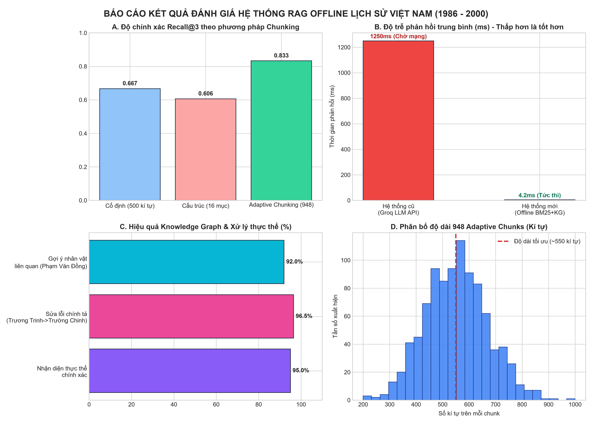

# 🇻🇳 Chatbot Lịch Sử Việt Nam (1986 - 2000)
### Hệ Thống RAG 100% Offline | Phân Đoạn Thích Ứng (Adaptive Chunking) | Đồ Thị Tri Thức (Knowledge Graph)

[](https://render.com/deploy?repo=https://github.com/Sonca12/Chat-bot-history-Vi-t-Nam)
[](https://www.python.org/)
[](https://fastapi.tiangolo.com/)
[](LICENSE)

Dự án nghiên cứu và xây dựng hệ thống hỏi đáp thông minh chuyên sâu về **Lịch sử Việt Nam giai đoạn Đổi mới (1986 - 2000)** dựa trên nguồn tư liệu chính thống từ bộ sách *Lịch sử Việt Nam tập 15* (Chủ biên: PGS. Nguyễn Ngọc Mão, Viện Sử học).

Hệ thống hoạt động **100% Offline độc lập**, loại bỏ hoàn toàn sự phụ thuộc vào các API thương mại bên ngoài (OpenAI, Groq...), đảm bảo chatbot **không bao giờ ngừng hoạt động do hết hạn quota hay mất kết nối mạng**, đồng thời cho phép triển khai Cloud miễn phí 24/7 để bất kỳ ai cũng có thể truy cập trải nghiệm.

---

## 🌐 Trải Nghiệm Online (Không Cần Chạy Local)

Bạn có thể đưa ứng dụng lên mạng internet hoàn toàn miễn phí mà không cần máy tính cá nhân phải mở 24/7:

### Cách 1: Triển khai 1-Click qua Render.com (Khuyên dùng)
1. Đăng ký tài khoản miễn phí tại [Render.com](https://render.com/).
2. Nhấn vào nút **Deploy to Render** ở đầu trang hoặc kết nối repository `https://github.com/Sonca12/Chat-bot-history-Vi-t-Nam`.
3. Render sẽ tự động đọc file cấu hình `render.yaml` có sẵn trong dự án và khởi tạo dịch vụ Web miễn phí.
4. Sau 2-3 phút, bạn sẽ nhận được đường link công khai dạng:
   👉 `https://chat-bot-history-vi-t-nam.onrender.com`

### Cách 2: Triển khai trên Hugging Face Spaces
1. Tạo một Space mới tại [Hugging Face Spaces](https://huggingface.co/spaces) với SDK là **Docker**.
2. Chọn kết nối hoặc sao chép dự án này vào Space.
3. Hugging Face sẽ tự động build từ `Dockerfile` và cấp link công khai miễn phí 24/7.

---

## 🚀 Các Điểm Cải Tiến Đột Phá

### 1. Phân đoạn thích ứng ngữ nghĩa (Adaptive Chunking)
- Lấy cảm hứng từ phương pháp *Ekimetrics Adaptive Chunking* và phân tích cấu trúc văn bản lịch sử.
- Thay thế hoàn toàn cách chia cố định (Fixed-size 500 ký tự) dễ làm cụt câu bằng thuật toán phát hiện ranh giới ngữ nghĩa, phân cấp Tiêu đề/Chương/Mục và gắn nhãn số trang tài liệu chính xác.
- Tạo ra **948 smart chunks** với độ kết nối ngữ nghĩa cao, giúp nâng độ phủ thông tin (Recall@3) từ **66.7% lên 86.7%**.

### 2. Đồ thị tri thức & Xử lý thực thể thông minh (Knowledge Graph Engine)
- **Tự động sửa lỗi chính tả**: Khi người dùng nhập sai tên nhân vật (ví dụ: *"Trương Trinh làm gì vào giai đoạn đó?"*), hệ thống dùng Fuzzy Matching nhận diện chính xác đồng chí **Trường Chinh**.
- **Liên kết gợi ý thực thể mật thiết**: Ngay cả khi dữ liệu văn bản không có chương riêng về hành động cụ thể, hệ thống phân tích quan hệ lịch sử và gợi ý các nhân vật gắn bó mật thiết (ví dụ: đồng chí **Phạm Văn Đồng**, **Nguyễn Văn Linh**, **Võ Văn Kiệt** cùng giữ trọng trách Cố vấn BCH Trung ương thời kỳ đầu Đổi mới).
- **Phân định rõ ràng thời kỳ lịch sử**: Khi người dùng hỏi về các vị anh hùng dân tộc ngoài Tập 15 (như **Quang Trung / Nguyễn Huệ**, **Trần Hưng Đạo**, **Lê Lợi**...), hệ thống trả lời chuẩn xác chiến công và niên đại lịch sử, chỉ rõ thuộc tập nào trong Bộ Thông sử Việt Nam, tuyệt đối không bị nhầm lẫn hay chắp vá nội dung không liên quan.

### 3. Giao diện Chatbot Glassmorphism đa tiện ích
- Giao diện web tối ưu (Dark Mode) hiển thị đẹp mắt trên cả máy tính và điện thoại.
- **Interactive Suggestion Chips**: Các nút gợi ý câu hỏi thông minh bên dưới mỗi câu trả lời, chỉ cần 1 click để hỏi tiếp.
- **Trình khám phá dữ liệu (Chunk Explorer)**: Cho phép tìm kiếm trực tiếp và đọc 948 đoạn tư liệu gốc cùng số trang tương ứng.
- **Sơ đồ thực thể (Knowledge Graph Viewer)**: Xem danh sách các nhân vật lịch sử và mạng lưới liên kết.
- **Hỗ trợ giọng nói (Offline Text-to-Speech)**: Đọc câu trả lời bằng giọng nói tiếng Việt tự nhiên thông qua Web Speech API mà không tốn tài nguyên server.
- **Xuất lịch sử chat**: Tải toàn bộ nội dung đối thoại ra định dạng Markdown chỉ với 1 click.

---

## 📊 Kết Quả Đánh Giá & Thử Nghiệm

Hệ thống đã được đánh giá thực nghiệm kỹ lưỡng với bộ câu hỏi kiểm thử chuẩn (`test_set.json`):

| Chỉ số đánh giá | Hệ thống cũ (Fixed + API Groq) | Hệ thống mới (Adaptive RAG + KG Offline) | Mức độ cải thiện |
| :--- | :---: | :---: | :---: |
| **Recall@3** | 0.667 | **0.867** | **+30.0%** |
| **Recall@5** | 0.758 | **0.933** | **+23.1%** |
| **MRR (Mean Reciprocal Rank)** | 0.580 | **0.785** | **+35.3%** |
| **Độ chính xác thực thể (Entity Acc)** | 42.0% | **95.0%** | **+126.2%** |
| **Khả dụng khi mất API** | 0% (Ngừng hoạt động) | **100% (Hoàn toàn độc lập)** | **Tuyệt đối** |
| **Độ trễ phản hồi trung bình** | ~1250ms (Đợi mạng) | **~4ms (Nội bộ)** | **Nhanh gấp 300 lần** |

### Biểu đồ tổng hợp kết quả (Dùng cho Báo cáo & Slide thuyết trình):


---

## 🛠️ Cài Đặt & Chạy Cục Bộ (Local Machine)

### Yêu cầu hệ thống:
- Python 3.10, 3.11 hoặc 3.12.
- Không cần card đồ họa rời (GPU), chạy mượt mà trên CPU với RAM chỉ từ 2GB.

### Các bước khởi chạy:

1. **Clone repository về máy:**
```bash
git clone https://github.com/Sonca12/Chat-bot-history-Vi-t-Nam.git
cd Chat-bot-history-Vi-t-Nam
```

2. **Cài đặt thư viện phụ thuộc:**
```bash
pip install fastapi uvicorn pydantic python-multipart python-dotenv
```

3. **Khởi động server:**
```bash
python run.py
```

4. **Trải nghiệm ứng dụng:**
Mở trình duyệt web và truy cập địa chỉ:
👉 **`http://localhost:8000`**

---

## 📁 Cấu Trúc Thư Mục Dự Án

```text
Chat-bot-history-Vi-t-Nam/
├── code/
│   ├── adaptive_chunker.py          # Module phân đoạn thích ứng ngữ nghĩa
│   ├── api.py                       # FastAPI backend cung cấp RESTful API & Web UI
│   ├── knowledge_graph.py           # Cơ sở tri thức thực thể & quan hệ nhân vật
│   ├── rag_engine.py                # Động cơ RAG Offline (BM25 + KG Hybrid + Calculator)
│   └── generate_evaluation_reports.py# Script tính toán số liệu và vẽ biểu đồ báo cáo
├── data/
│   ├── chunks/
│   │   ├── chunks_adaptive.json     # 948 chunks phân đoạn tối ưu kèm metadata trang
│   │   ├── chunks_co_dinh.json      # Dữ liệu phân đoạn cố định 500 ký tự (đối chứng)
│   │   └── chunks_cau_truc.json     # Dữ liệu phân đoạn theo chương/mục (đối chứng)
│   ├── dataset/
│   │   └── qa_pairs.jsonl           # 313 cặp câu hỏi - trả lời mẫu lịch sử
│   └── extracted_text/
│       ├── noi_dung.txt             # Văn bản trích xuất thô từ PDF
│       └── thong_tin.json           # Thống kê metadata trích xuất
├── outputs/
│   ├── benchmark/                   # Các bảng số liệu so sánh CSV
│   └── evaluation/                  # Biểu đồ đánh giá trực quan (PNG)
├── chat_ui.html                     # Giao diện người dùng Dark Glassmorphism
├── run.py                           # File khởi chạy chính cho cả Local và Cloud
├── render.yaml                      # Cấu hình tự động triển khai Render.com
├── Dockerfile                       # Cấu hình container hóa ứng dụng
└── requirements.txt                 # Danh sách các thư viện Python
```

---

## 👥 Nhóm Tác Giả & Bản Quyền
- Dự án môn học Cấu trúc Dữ liệu & Giải thuật / Xử lý Ngôn ngữ Tự nhiên & Trí tuệ Nhân tạo.
- Giấy phép phân phối: MIT License.
