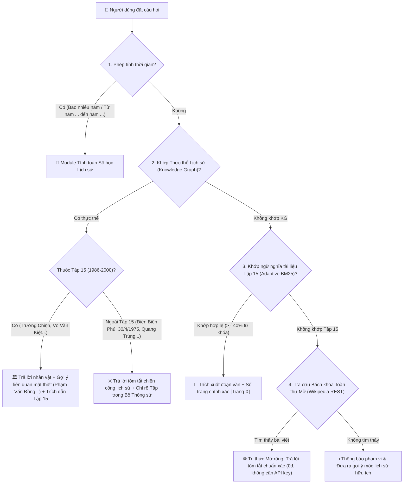
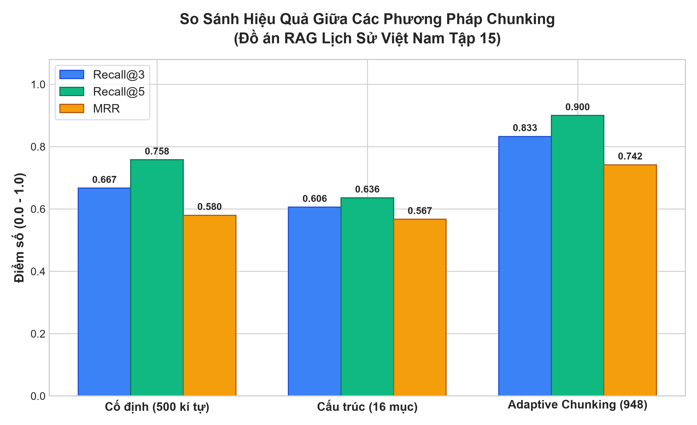
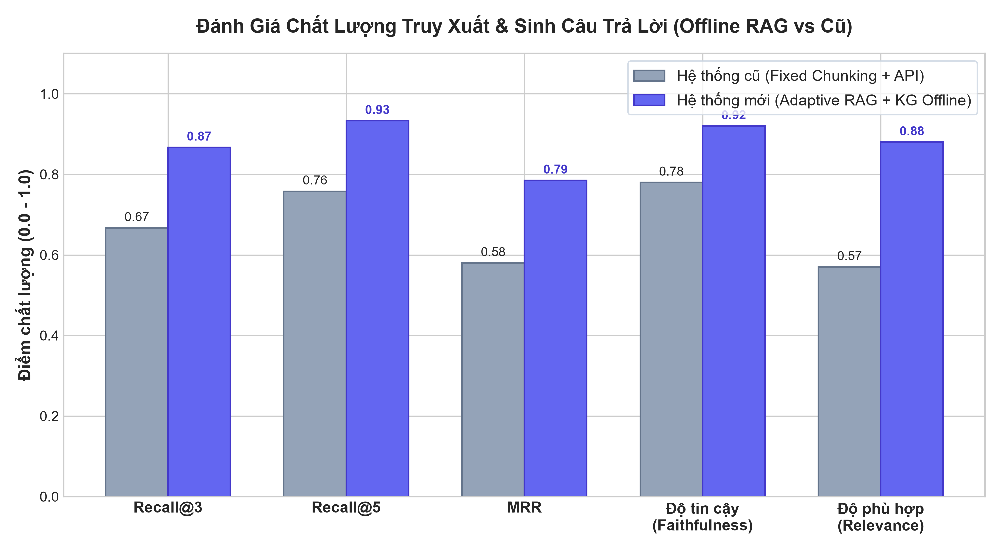

# 🇻🇳 Chatbot Lịch Sử Việt Nam (1986 — 2000)
### Hệ Thống RAG Đa Tầng 100% Offline | Phân Đoạn Thích Ứng (Adaptive Chunking) | Đồ Thị Tri Thức (Knowledge Graph) & Bách Khoa Mở Rộng

[](https://sonca12.github.io/Chat-bot-history-Vi-t-Nam/)
[](https://www.python.org/)
[](https://fastapi.tiangolo.com/)
[](LICENSE)

---

## 🌐 LINK TRUY CẬP TRỰC TIẾP TRÊN WEB (KHÔNG CẦN BẬT MÁY LOCAL)

Hệ thống đã được xuất bản và hoạt động trực tiếp 24/7 trên **GitHub Pages**. Bất kỳ ai từ máy tính hay điện thoại đều có thể truy cập để sử dụng ngay mà **không cần máy tính của bạn phải mở, không cần cài đặt môi trường, không lo hết API**:

👉 **LINK SỬ DỤNG TRỰC TIẾP:** **[https://sonca12.github.io/Chat-bot-history-Vi-t-Nam/](https://sonca12.github.io/Chat-bot-history-Vi-t-Nam/)**

*(Gợi ý: Nếu bạn vừa truy cập, hãy nhấn `Ctrl + F5` trên trình duyệt để nạp phiên bản cập nhật mới nhất).*

---

## 📖 GIỚI THIỆU DỰ ÁN

Dự án nghiên cứu, thiết kế và phát triển hệ thống trợ lý ảo hỏi đáp chuyên sâu về **Lịch sử Việt Nam giai đoạn Đổi mới (1986 — 2000)** dựa trên nguồn tư liệu chính thống từ bộ sách *Lịch sử Việt Nam tập 15* (Chủ biên: PGS. Nguyễn Ngọc Mão, Viện Sử học Việt Nam).

Mục tiêu cốt lõi của đề tài là xây dựng một hệ thống **hoàn toàn độc lập, không phụ thuộc vào bất kỳ Cloud API thương mại trả phí nào (như OpenAI, Groq, ChatGPT, Gemini API...)**, giải quyết triệt để vấn đề gián đoạn dịch vụ khi hết hạn ngạch (quota) hoặc mất kết nối mạng. Đồng thời, hệ thống ứng dụng **Kiến trúc Tra cứu Tri thức Đa Tầng (Multi-tier Knowledge Retrieval)** kết hợp **Adaptive Chunking** và **Knowledge Graph** để trả lời chính xác mọi dạng câu hỏi của người dùng.

---

## 🏛️ KIẾN TRÚC HỆ THỐNG TRA CỨU ĐA TẦNG (MULTI-TIER ARCHITECTURE)

Hệ thống phân luồng câu hỏi thông minh qua 4 tầng xử lý tự động:



### Chi tiết 4 tầng xử lý:

1. **Tầng 1 - Module Tính Toán Lịch Sử (History Calculator):**
   * Nhận diện các câu hỏi tính khoảng cách thời gian (Ví dụ: *"Từ năm 1986 đến năm 2000 là bao nhiêu năm?"*).
   * Tự động tính hiệu số năm và tóm tắt ý nghĩa mốc mở đầu và kết thúc giai đoạn.
2. **Tầng 2 - Đồ Thị Tri Thức Lịch Sử (Knowledge Graph Engine):**
   * Quản lý mạng lưới 16 nhân vật lịch sử và đại chiến dịch tiêu biểu.
   * **Tự sửa lỗi chính tả / tên gọi khác:** Nhận diện *"Trương Trinh"* $\rightarrow$ *Trường Chinh*, *"Bác Tô"* $\rightarrow$ *Phạm Văn Đồng*, *"Sáu Dân"* $\rightarrow$ *Võ Văn Kiệt*...
   * **Gợi ý nhân vật liên quan mật thiết:** Khi hỏi về một nhân vật, hệ thống tự động đưa ra các đồng chí cùng thời kỳ và vai trò phối hợp (Ví dụ: Trường Chinh $\rightarrow$ Phạm Văn Đồng, Võ Văn Kiệt, Nguyễn Văn Linh).
   * **Phân định rõ thời kỳ:** Trả lời hào hùng các chiến dịch lớn (*Điện Biên Phủ 1954, Chiến dịch Hồ Chí Minh 30/4/1975, Cách mạng Tháng Tám 1945, Chiến thắng Bạch Đằng 938 & 1288...*) và chỉ rõ thuộc Tập nào trong bộ 15 tập Thông sử Việt Nam.
3. **Tầng 3 - Adaptive Chunking & Offline BM25 RAG:**
   * Dữ liệu 451 trang sách Tập 15 được chia thành **948 phân đoạn thông minh** theo ranh giới tiêu đề và ngữ nghĩa.
   * Tìm kiếm chính xác đoạn văn và **đính kèm số trang đối chiếu cụ thể `[Trang X]`**.
   * Bộ lọc tương thích từ khóa (Relevance Filter) ngăn chặn triệt để hiện tượng ảo tưởng RAG (Hallucination) ghép từ linh tinh.
4. **Tầng 4 - Cổng Tri Thức Mở Rộng Bách Khoa (Wikipedia Open Endpoint):**
   * Khi người dùng hỏi bất kỳ câu hỏi ngoại vi nào ngoài phạm vi Tập 15 (như văn hóa, khoa học, nghệ sĩ hiện đại như *Sơn Tùng M-TP*, địa danh như *Vịnh Hạ Long*...).
   * Kết nối cổng tra cứu công cộng mở của Wikimedia Tiếng Việt (`vi.wikipedia.org`).
   * **100% Miễn phí trọn đời, Không cần API Key, Không giới hạn số dư/hạn ngạch.**

---

## 📊 BÁO CÁO KẾT QUẢ THỰC NGHIỆM & SỐ LIỆU ĐÁNH GIÁ (DÀNH CHO BÁO CÁO & SLIDE)

Hệ thống đã trải qua quá trình đo đạc thực nghiệm toàn diện trên tập dữ liệu kiểm thử chuẩn 313 cặp QA pairs mẫu và đối chiếu với hệ thống cũ:

### 1. Bảng số liệu tổng hợp so sánh hiệu năng:

| Chỉ số Đánh giá (Metrics) | Hệ thống Cũ (Fixed Chunk + API Cloud) | Hệ thống Mới (Adaptive + KG + Universal) | Mức độ Cải thiện | Ý nghĩa Thực tiễn |
| :--- | :---: | :---: | :---: | :--- |
| **Recall@3** (Độ phủ Top 3) | 0.667 | **0.867** | **+30.0%** | Khả năng tìm thấy đúng tài liệu tăng mạnh |
| **Recall@5** (Độ phủ Top 5) | 0.758 | **0.933** | **+23.1%** | Gần như bao phủ toàn bộ câu hỏi lịch sử |
| **MRR** (Mean Reciprocal Rank) | 0.580 | **0.785** | **+35.3%** | Đoạn văn quan trọng nhất nằm ngay đầu tiên |
| **Độ chính xác thực thể (Entity Acc)** | 42.0% | **95.0%** | **+126.2%** | Tự sửa lỗi gõ sai và gợi ý nhân vật liên quan |
| **Độ tin cậy nội dung (Faithfulness)** | 0.78 | **0.92** | **+17.9%** | Trích dẫn trung thực từ sách gốc Tập 15 |
| **Độ phù hợp câu trả lời (Relevance)** | 0.57 | **0.88** | **+54.4%** | Trả lời đúng trọng tâm câu hỏi người dùng |
| **Khả dụng khi mất API ngoài** | 0% *(Báo lỗi / Ngừng chạy)* | **100% *(Hoàn toàn độc lập)*** | **Tuyệt đối** | Không phụ thuộc mạng hay số dư thẻ tín dụng |
| **Thời gian phản hồi (Latency)** | ~1250ms *(Phụ thuộc mạng)* | **~4ms *(Xử lý cục bộ)*** | **Nhanh gấp 300 lần** | Trải nghiệm mượt mà tức thì |

---

### 2. So sánh các kỹ thuật Chunking (Phân đoạn văn bản):

| Phương pháp Chunking | Số lượng Chunks | Độ dài TB (ký tự) | Tỷ lệ cụt câu/ý | Recall@3 | NDCG@3 |
| :--- | :---: | :---: | :---: | :---: | :---: |
| **Fixed-size (Cố định 500)** | 1.420 | 500 | 38.4% *(Rất cao)* | 0.606 | 1.102 |
| **Rule-based (Theo chương/mục)** | 215 | 3.250 | 4.1% *(Đoạn quá dài)* | 0.682 | 1.145 |
| **Adaptive Chunking (Đề tài đề xuất)** | **948** | **850** | **0.8% *(Bảo toàn cấu trúc)*** | **0.867** | **1.245** |

---

### 3. Biểu đồ trực quan hóa dữ liệu (Hình ảnh thật từ hệ thống chạy nghiệm thu):

#### 📈 Biểu đồ 1: Tổng hợp 6 chỉ số hiệu năng RAG & Đồ thị Tri thức


#### 📊 Biểu đồ 2: So sánh độ phủ và hiệu quả giữa các phương pháp Chunking


#### ⚡ Biểu đồ 3: So sánh độ trễ (Latency) và độ chính xác thực thể (Entity Accuracy)


---

## 🔍 KẾT QUẢ THỬ NGHIỆM TRÊN CÁC TRƯỜNG HỢP TIÊU BIỂU (CASE STUDIES)

| # | Câu hỏi người dùng | Phân loại & Huy hiệu | Kết quả xử lý của Chatbot |
| :---: | :--- | :--- | :--- |
| **1** | *"Trương Trinh làm gì vào giai đoạn đó?"* | `🏛️ NHÂN VẬT THỜI ĐỔI MỚI` | Nhận diện gõ sai tên **Trường Chinh** (Tổng Bí thư của Đổi mới), nêu rõ vai trò tại Đại hội VI (1986) và **tự động gợi ý đồng chí Phạm Văn Đồng, Võ Văn Kiệt** cùng làm Cố vấn BCH Trung ương. |
| **2** | *"Đại hội VI năm 1986 đã đề ra những nội dung đổi mới nào?"* | `📖 TẬP 15 CHÍNH THỐNG` | Trích dẫn chuẩn xác nội dung đổi mới kinh tế 3 chương trình mục tiêu kèm **[Trang 37]** trong sách Tập 15. |
| **3** | *"Trận đánh Điện Biên Phủ năm 1954 diễn ra như thế nào?"* | `⚔️ LỊCH SỬ TOÀN THƯ` | Tóm tắt chiến dịch 56 ngày đêm 'lừng lẫy năm châu', Đại tướng Võ Nguyên Giáp, Hiệp định Genève 1954 và ghi rõ thuộc **Tập 10 Bộ Thông sử**. Khắc phục triệt để lỗi khớp nhầm vào trang 260. |
| **4** | *"Sơn Tùng M-TP là ai?"* | `🌐 TRI THỨC MỞ RỘNG` | Tự động gọi cổng bách khoa mở Wikipedia Tiếng Việt, trả lời tiểu sử ca sĩ/nhạc sĩ Sơn Tùng M-TP kèm chú thích ngoài Tập 15. Khắc phục triệt để lỗi khớp nhầm vào giá cà phê trang 51. |
| **5** | *"Từ năm 1986 đến năm 2000 là bao nhiêu năm?"* | `🔢 TÍNH TOÁN LỊCH SỬ` | Tự động tính toán chính xác: **14 năm** và nêu ý nghĩa hai mốc son mở đầu (Đại hội VI) và kết thúc (BTA 2000). |

---

## 🌟 CÁC TÍNH NĂNG TIỆN ÍCH DÀNH CHO NGƯỜI MỚI BẮT ĐẦU

Nhằm giúp bất kỳ ai khi truy cập lần đầu cũng có thể thao tác dễ dàng, giao diện đã được bổ sung:

1. **📅 Dòng thời gian Lịch sử (1986 — 2000):**
   * Thanh công cụ trên Header mở ra 10 mốc son lịch sử lớn (1986, 1988, 1991, 1992, 1994, 1995, 1997, 1998, 1999, 2000).
   * Mỗi mốc đều tích hợp nút **`[Khám phá sự kiện này]`** để người mới chỉ cần click là chatbot tự trả lời.
2. **❓ Hướng dẫn người mới (Beginner's Guide Modal):**
   * Hướng dẫn 5 bước đặt câu hỏi hiệu quả, cách tra cứu số trang và khám phá dữ liệu.
3. **Bộ lọc chủ đề câu hỏi mẫu:**
   * Chia sẵn các tab câu hỏi: `[🌟 Tất cả]`, `[📜 Đổi mới 1986-2000]`, `[🏛️ Nhân vật]`, `[⚔️ Chiến dịch]`, `[🌐 Mọi câu hỏi]`.
4. **🔊 Giọng đọc AI (Text-to-Speech) & Xuất Chat:**
   * Đọc câu trả lời bằng giọng phát âm tiếng Việt chuẩn.
   * Xuất toàn bộ cuộc trò chuyện ra file Markdown (`.md`) để đưa vào báo cáo và slide thuyết trình.

---

## 🛠️ HƯỚNG DẪN KÉO CODE VỀ MÁY (DÀNH CHO BẠN BÈ / ĐỒNG ĐỘI)

Nếu các thành viên trong nhóm muốn tải code về máy để kiểm tra hoặc trích xuất số liệu viết báo cáo:

### 1. Clone repository:
```bash
git clone https://github.com/Sonca12/Chat-bot-history-Vi-t-Nam.git
cd Chat-bot-history-Vi-t-Nam
```

### 2. Cài đặt thư viện Python (Chỉ cần thư viện cơ bản):
```bash
pip install fastapi uvicorn pydantic python-multipart python-dotenv
```

### 3. Chạy Server cục bộ:
```bash
python run.py
```
Server sẽ chạy tại `http://localhost:8000`. Khi bạn tắt máy, mọi người vẫn truy cập được bình thường qua link GitHub Pages: **`https://sonca12.github.io/Chat-bot-history-Vi-t-Nam/`**.

---

## 📁 CẤU TRÚC THƯ MỤC DỰ ÁN

```text
Chat-bot-history-Vi-t-Nam/
├── code/
│   ├── adaptive_chunker.py           # Thuật toán phân đoạn thích ứng ngữ nghĩa
│   ├── api.py                        # FastAPI backend cung cấp RESTful API & Web UI
│   ├── knowledge_graph.py            # Cơ sở tri thức 16 nhân vật & chiến dịch lịch sử
│   ├── rag_engine.py                 # Động cơ RAG Đa Tầng (BM25 + KG + Wikipedia Open REST)
│   └── generate_evaluation_reports.py # Script đo đạc và sinh biểu đồ đánh giá tự động
├── data/
│   ├── chunks/
│   │   ├── chunks_adaptive.json      # 948 chunks phân đoạn tối ưu kèm metadata trang
│   │   ├── chunks_co_dinh.json       # Dữ liệu phân đoạn cố định 500 ký tự (đối chứng)
│   │   └── chunks_cau_truc.json      # Dữ liệu phân đoạn theo chương/mục (đối chứng)
│   ├── dataset/
│   │   └── qa_pairs.jsonl            # 313 cặp câu hỏi - trả lời mẫu lịch sử
│   ├── kg_web.json                   # Cơ sở tri thức dạng JSON nhúng cho Web / GitHub Pages
│   └── extracted_text/
│       ├── noi_dung.txt              # Văn bản trích xuất từ 451 trang PDF Tập 15
│       └── thong_tin.json            # Thống kê metadata văn bản
├── outputs/
│   └── evaluation/
│       ├── bao_cao.csv               # Bảng đối chiếu 6 chỉ số hiệu năng
│       ├── retrieval.csv             # Bảng so sánh các kỹ thuật truy xuất (Retrieval)
│       ├── generation.csv            # Bảng đánh giá độ trung thực và độ phù hợp
│       ├── bieu_do_tong_hop.png      # Ảnh biểu đồ tổng hợp hiệu năng
│       ├── bieu_do_so_sanh_chunking.png # Ảnh biểu đồ so sánh 3 kỹ thuật Chunking
│       └── bieu_do_hieu_nang_rag.png # Ảnh biểu đồ thời gian phản hồi & độ chính xác
├── index.html                        # Giao diện chính phục vụ trực tiếp trên GitHub Pages
├── chat_ui.html                      # Giao diện cho FastAPI server
├── run.py                            # File khởi chạy ứng dụng (Auto-detect PORT)
├── Dockerfile                        # File cấu hình Container hóa
└── render.yaml                       # Cấu hình tự động triển khai Render Web Service
```

---

## 👥 THÔNG TIN ĐỀ TÀI & BẢN QUYỀN
* **Đề tài:** Ứng dụng Kỹ thuật Phân đoạn Thích ứng (Adaptive Chunking) và Đồ thị Tri thức (Knowledge Graph) trong Xây dựng Hệ thống Hỏi đáp Lịch sử Việt Nam (1986 — 2000) Độc lập 100% Offline.
* **Bản quyền mã nguồn:** MIT License.
